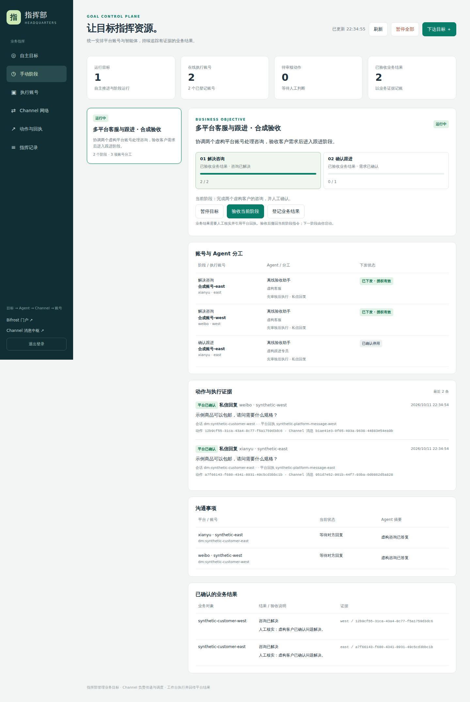

# headquarters

[](LICENSE)

独立运行的业务目标指挥部。Multica 提供原生规划和项目任务记录；总部向社交工作台提交业务任务，
工作台拥有账号和实际平台操作，需要模型时复用 Channel 与 Multica，结果回传总部持续推进。Python / Flask、原生 HTML/JS、SQLite WAL。

## 界面预览

以下为临时演示环境截图，使用虚构业务目标和账号。



## 本机启动

安装 **Python 3.10+**：

```bash
git clone https://github.com/liuyishoua/headquarters.git
cd headquarters
python3 -m venv .venv
.venv/bin/python -m pip install -r requirements.txt
.venv/bin/python -m headquarters
```

打开 **http://127.0.0.1:8781**。首次启动生成独立访问密码，保存在 `.local/admin-password`。
初始目标和账号为空；配置 Multica、Channel 留痕连接与工作台业务接口，再为目标选择账号权限。按 Ctrl+C 停止。
本项目没有 `--demo` 参数；隔离验收使用测试中的临时存储与模拟连接。

## 连接与使用

连接字段见 [部署说明](docs/operations.md)。机器控制凭据与浏览器登录凭据独立管理。
创建目标不会绕过平台账号权限；只允许实际具备相应能力的在线账号执行。
阶段推进与业务结果验收由用户确认，模型提案、平台送达回执和业务成果分别记录。
暂停目标会撤回下游执行授权；授权过期保留事件并停止领取新动作。

## 自主目标

默认页面可下达自主目标，填写交付标准，并分别勾选平台、执行账号和操作。
每个账号的授权独立保存；不可用操作显示原因，修改授权会影响后续执行。
目标引擎持续保存行动、观察和下一次检查时间；暂停、停止、期限和行动额度
均由执行层检查。用户可以补充资料和反馈，成果文件可直接下载。

自主规划需要服务端 `.local/autonomy.json` 配置。已有 Multica 接入可配置
`multica_config_file` 和专用 `planner_agent_id`；规划身份应禁用平台操作工具。
目标通过现有 Multica API 关联 Project、主任务、行动与结果，未修改 Multica 核心。
服务端 `workbenches` 配置各工作台业务入口：小红书使用专用受限业务凭据，闲鱼复用正常工作台认证。
新平台执行统一用工作台持久任务；旧直接 Channel 行动仅核对在途结果。
模型输出和本地草稿是中间产物，工作台核验的平台结果才可计执行回执。
当前操作与条件详见 [自主目标与工作台执行](docs/autonomous-goals.md)。
原有手动阶段目标仍保留在“阶段目标”页。

文档交付依据预先配置的文件与必含事实检查，并保留来源证据；这只能验证
配置的检查项，不能保证文档的全部事实正确。真实成交、线下体验和交付
不会因为生成文案、任务执行成功或发出消息而自动记为完成。
平台能力以页面实际可用目录为准，缓存读取、真实平台操作、未接通接口明确区分。

## 数据与备份

- `.local/`：密码、连接配置、业务台账和数据库，全部忽略 Git。
- 指令使用单调版本、短期授权与幂等确认，服务重启后保留业务状态。
- 备份前停止服务并复制整个 `.local/`。

## 安装与验证

```bash
.venv/bin/python -m pip install -r requirements-dev.txt
.venv/bin/python -m unittest discover -s tests -v
node --check headquarters/static/app.js
```

自动测试使用临时数据库和虚构账号，不做真实社交写入。原生模型和真实主页只读验收为显式运行脚本，报告分别记录真实数据与合成平台边界。

## 目录

- `headquarters/`：业务目标、资源、阶段、指令台账和管理界面。
- `tests/`、`scripts/`：隔离验证工具；`deploy/`：部署示例。
- `docs/`：架构、API、运维及 [完整功能说明](docs/operations-original.md)。

## 使用许可

**本项目仅供学习、研究、测试及其他非商业用途，不得用于商业目的。**
对本仓库中版权所有者拥有权利的代码，采用
[PolyForm Noncommercial License 1.0.0](LICENSE)；商业使用须事先取得版权所有者的单独授权。
本项目属于**源码可见、限制商用**，不应标为 MIT 或 OSI 意义上的开源许可证。

第三方代码、素材和依赖仍受其各自许可条件约束，来源与许可范围见
[THIRD_PARTY_NOTICES.md](THIRD_PARTY_NOTICES.md)。本声明不追溯改变第三方代码或此前已发布版本的许可。
