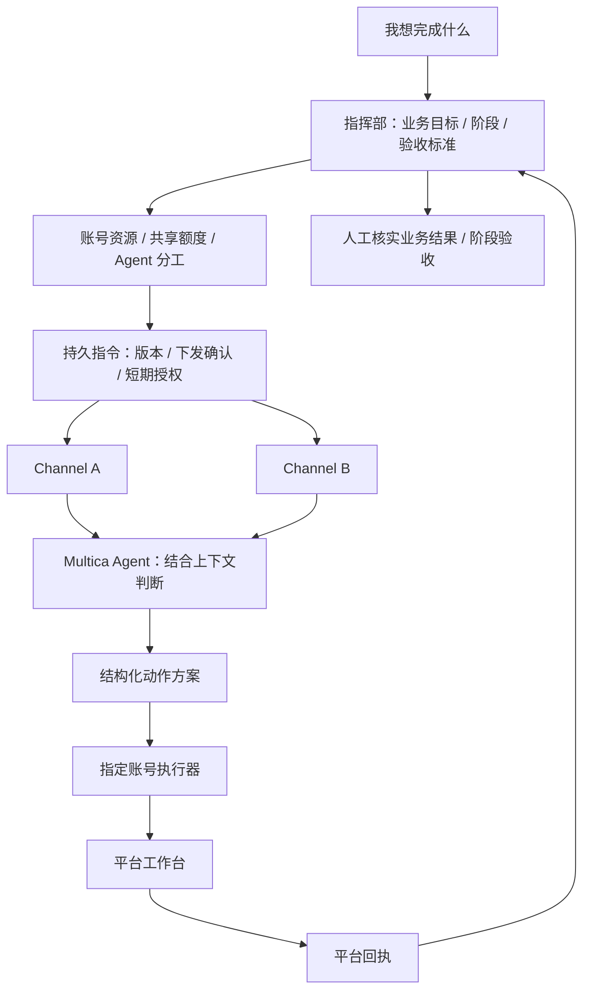

# 指挥部 · Headquarters

以业务目标为中心的独立管理平台。定义要完成什么、阶段和验收标准，再分配不同 Channel、平台账号和 Multica agent，持续收集动作回执与业务结果。

- 正式入口：<https://d.58nft.net:9457/>；[Bifrost 门户](https://d.58nft.net/)。访问密码沿用用户指定的新增服务密码，保存在忽略的 `.local/admin-password`。
- 本机：`127.0.0.1:8781`；`headquarters.service`、`headquarters-proxy.service`。
- [业务与架构设计](docs/design.md) · [API 与操作流程](docs/api.md) · [部署维护](docs/operations.md)



## 已落地

- 独立进程、数据库、登录和 HTTPS 入口。Channel 不再拥有指挥部的业务目标。
- 一个目标包含有序阶段；每个阶段可分配多个平台账号、不同 Channel 和不同 agent。
- 共享业务知识、账号分工、阶段完成标准进入 agent 上下文；下一阶段可获得前阶段已核实的结果摘要。
- 资源目录展示 Channel 实际来源、Agent、执行器心跳和能力。登记账号不代表具备平台执行能力。
- 启动前检查实际执行能力、agent、来源、同账号同类事件冲突及 Channel 本地规则冲突。
- 账号统一配置共享额度、动作间隔和工作时间，下发到其所有分工；同一平台账号不能重复注册到两个 Channel。
- 目标暂停、集中暂停、阶段验收和完成均生成持久撤回指令。下一阶段显式启动，相关旧指令撤回未确认前不发新授权。
- Channel 使用独立机器凭据、单调指令版本、幂等下发和 90 秒授权。续约不改变路由版本，不撤销有效的待执行方案。每次批量续约最多 500 条；每个 Channel 独立后台线程。
- 授权过期保留新事件和模型待处理事项，暂停新模型任务和动作领取；恢复后继续处理仍有效的最新事项。
- 指挥部汇总动作、沟通事项、平台回执和已验收业务结果；同一客户业务标识去重。模型提案和“消息已发送”分别记账。
- SQLite WAL 保存指令和结果，变更游标分页消费；丢失下发响应、延迟回执和服务重启不会凭空复制业务成果。

## 当前能力边界

正式环境接入一个 Channel，目录包含八个平台来源和现有 Multica agents。没有在本次部署中启动真实平台执行器，也没有自动接管 Channel 原有规则。首次进入的目标和账号列表为空，可自行创建。

闲鱼文字私信执行器已有实现，仍未启用。其他平台的持续私信监听、评论执行和图文发布需逐个平台适配。管理界面只会允许具备实际能力的在线账号启动对应目标，不会因为存在平台入口就显示为可执行。

阶段分解、账号选择、目标争用裁决和业务结果验收由用户配置；agent 在授权范围内判断具体回复和跟进。尚未实现总指挥 agent 自动拆解目标、自动挑选账号、自动跨平台识别人或自主认定成交。下一阶段启动会建立该阶段独立的执行事项，前阶段通过核实结果摘要交接，不混用不同 agent 的旧任务。

## 验证

```sh
python3 -m venv .venv
.venv/bin/pip install -r requirements-dev.txt
.venv/bin/python -m unittest discover -s tests -v
node --check headquarters/static/app.js
```

浏览器脚本需要环境已有的 Playwright：`../xianyu/.venv/bin/python scripts/acceptance.py`。真实模型测试：`.venv/bin/python scripts/model_acceptance.py --execute`，仅使用临时库与虚构账号，生成待审核方案，不发送平台消息。验收材料见 [docs/verification.json](docs/verification.json)。
